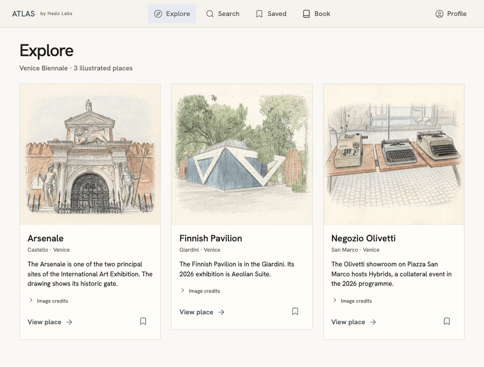
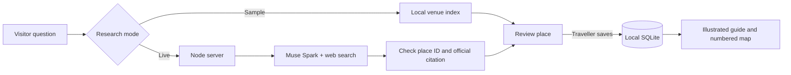

# Atlas by Hado Labs
**Map Your World.** · Meta Global AI Developer Hackathon · Startup Track · Build for Your World · November 4, 2026

**Integration clarification · November 5, 2026.** Atlas uses Meta Muse Spark for live research and Meta Muse Image in the full prototype's illustration workflow. The original demo export included artwork from a separate generation workflow. This post-submission correction replaces all three bundled illustrations with verified Meta Muse Image outputs and refreshes the demo media. [Correction and generation evidence](docs/ARTWORK-CORRECTION.md).

A traveller asks what to see at the Finnish Pavilion. Atlas can research the question with Meta, show the source beside the place, and let the traveller decide whether to save it. The saved venue becomes a page and a pin in their pocket guide.

Travel planning often leaves the map pin in one app, the source in a search tab and the itinerary in someone’s notes. Atlas keeps those pieces together.

## Judge access · hosted beta

**[Open the judge demo — no sign-in required](https://beta.hadolabs.co/judges)** · [Beta privacy](https://beta.hadolabs.co/privacy)

**Temporary public access ends at 12:00 a.m. Monday, November 9, 2026, Pacific Standard Time (Seattle)—the start of Monday.** The link and all existing judge-demo sessions expire automatically at that time.

Click the link to enter the larger Atlas prototype in your browser. No account, approval, local installation, or Meta API key is needed. Try **Explore → Search → Saved → Book**: discover a place, inspect its sources, save it, and open its guide page.

Each demo visit has its own saved collection; no permanent account is created. Live AI research uses a capped allowance shared by demo visitors. You can still browse the available places and build a guide if that allowance is used up. Owner and editorial workspaces remain private.

After the demo closes, [request a personal account](https://beta.hadolabs.co/register) or [sign in to an approved account](https://beta.hadolabs.co/login). You can also [watch the full prototype](#watch-the-full-atlas-prototype) or [run the three-venue Venice sample](#run-the-demo) at any time.

*Hosted beta access added November 6, 2026, after the hackathon submission.*

## Run the Venice sample

This checkout includes three illustrated venues. [Start the local app](#run-the-demo) to search, save a place, and open its guide page. Sample mode works without an API key. [Live Meta research](#try-real-meta-research) is optional.



The 14-second preview follows a search for **wind** through saving the Finnish Pavilion and opening its page from pin **1**. Captured November 6, after submission.

## Watch the full Atlas prototype

[Download the full prototype video (MP4, 6:33, silent, 2× speed)](https://github.com/Catherine-1122/morrow-17/raw/refs/heads/main/docs/walkthrough.mp4) · [Scene timestamps](docs/WALKTHROUGH.md#full-atlas-prototype) · [Artwork and map credits](docs/CREDITS.md)

The recording shows globe navigation and searches in Seattle and Los Angeles from the larger hackathon app. Run the Venice sample above to try the public implementation.

The public sample includes **Explore, Search, Saved, Book and Profile**. Its Profile introduces the three roles and includes a reduced-motion setting; it does not provide account registration or access to private workspaces. For the separately hosted full prototype, use [Judge access](#judge-access--hosted-beta) above.

## Run the demo

Use **Node.js 24 or newer** with npm. From the root of this checkout:

```sh
npm start
```

Open [Atlas on this computer](http://127.0.0.1:4173). There are zero third-party runtime packages. Startup creates a local SQLite database in `.atlas/`. It begins empty, so you can see your first save become a guide. No account, API key, download of map tiles or production service is required for Sample mode. Official source links open external sites when clicked.

1. Open **Search**, leave **Sample · offline** selected and enter **Architecture in Venice**. In this mode, the sample looks for all meaningful words across the venue name, area, tags and description. Try **Aeolian Suite** for one result or **glaciers in Venice** for none.
2. Open **Finnish Pavilion**, inspect the source or image credit, and save it. Add another venue from Explore.
3. Open **Saved** and refresh. The places persist on this demo server. **Book** opens a digital pocket guide in save order. Select **Map** and open pin **1** to read the Finnish Pavilion page and its official source. The **Cover** is separate. Switch to **Sketches** to unfold the sketch pages.
4. Open **Profile** to see the role overview and accessibility preference.

## Try real Meta research

Copy `.env.example` to `.env` and set `MODEL_API_KEY` to your own Meta API key with access to Muse Spark and web search. Restart `npm start`, select **Live Meta**, and ask **What can I see at the Finnish Pavilion in the Giardini?** Each submitted live search sends the question and the public venue list to Meta and uses your provider quota. The browser never receives the key.

To repeat the same live request from the terminal:

```sh
npm run meta:check
```

On November 4 we tested the public adapter against `muse-spark-1.3` at `POST https://api.meta.ai/v1/responses`. It used web search and returned a cited description of *Aeolian Suite*. The venue ID connected the answer to the existing map pin. Results can vary. [Actual sanitized response](docs/live-example.json) · [Integration and verification details](docs/INTEGRATION.md)



Meta interprets the live question, chooses relevant candidates, researches the listings and drafts a short explanation. The server accepts only known place IDs with a native citation on the same result line pointing to the venue’s listed official page. This check establishes the source of a result; the traveller can inspect the underlying claim. Map positions, edition artwork and venue descriptions come from the bundled samples. Saving from a live result also stores its explanation and official source on the venue page. The shared demo database stores the saved explanation without the original search question.

## Three people shape Atlas

| Role | Hackathon product | What a judge can use here |
| --- | --- | --- |
| Explorer | Discover places, save research, collect stops on a map and build a personal guide. | The complete three-venue search, save and digital guide journey. |
| Place owner | Submit better listing information for review. Claim verification is a product goal. | Consumer-facing place information and official links. The owner workspace is private. |
| Platform editor | Review research, writing, illustration provenance and publication decisions. | Meta-generated illustrations with public credits and generation records. The editorial workspace is private. |

## What was built

During **October 26–November 4, 2026**, the Atlas prototype connected map-scoped discovery to Meta research, added illustrated place cards and review, and joined persistent saves to a foldable digital guide. The guide preview, map interaction, artwork-credit disclosures, place visuals and visual identity are drawn from the working hackathon app.

For this release we selected three venues, wrote short sample descriptions from public listings, and added an isolated Node HTTP server, a small public Meta adapter and an empty demo save database. The protected editorial data, scoring methods, comparison tools and internal prompts are outside this repository. Hado Labs’ earlier visual and editorial practices predate the hackathon. Third-party fonts, icons and map data have their own histories and licenses.

**Stack** · Node HTTP and built-in SQLite, browser ES modules, HTML and CSS, Hanken Grotesk, Lucide, a locally rendered Venice map and the Meta Responses API.

**Verification** · [GitHub checks](https://github.com/Catherine-1122/morrow-17/actions/workflows/checks.yml) run the Node 24 tests, illustration hashes and Chromium guide checks on pushes and pull requests. Run `npm test` and `npm run artwork:check` locally without installing packages. [Browser test instructions and evaluation scope](docs/INTEGRATION.md#reproduction) · [Search cases and expected results](test/fixtures/search-cases.json)

**Public sample limits** · Discovery covers three mapped venues. Guide order follows save order; route optimization, offline downloads and printed orders are future work. The digital preview is interactive. Browser visitors to the same installation share its sample saves. This sample binds to loopback for local judging. The [hosted beta](#judge-access--hosted-beta) is a separate deployment with temporary judge access, approved personal accounts, and limited AI usage.

**Rights** · The repository includes no general open-source license for Hado Labs’ original code or brand. The contributed illustrations, font, icons and map carry the notices in [credits and licenses](docs/CREDITS.md).
