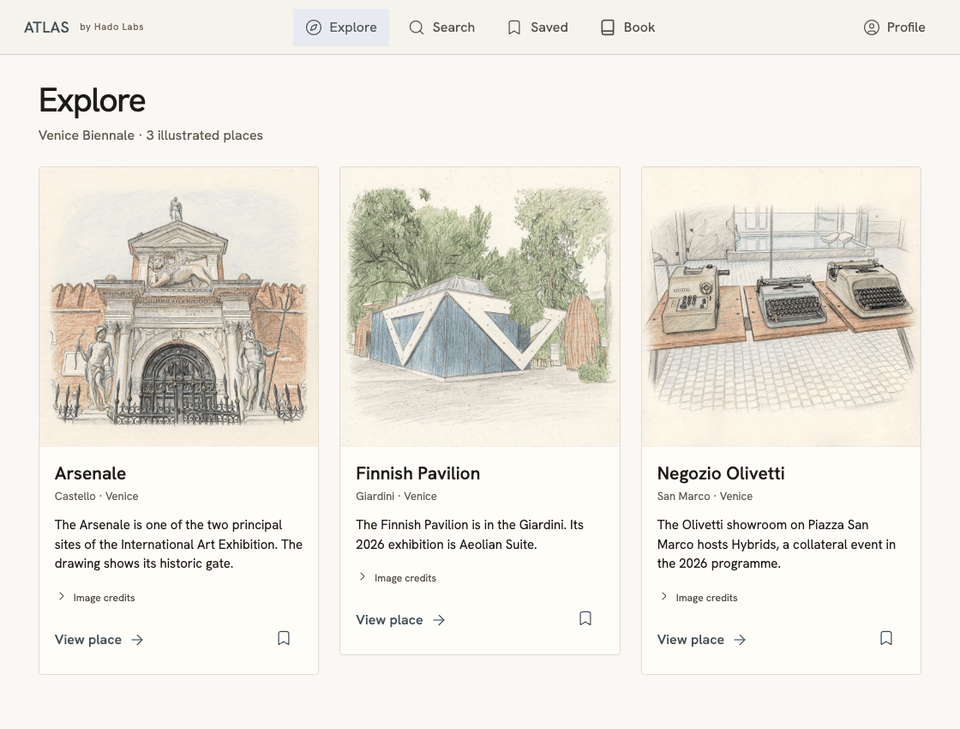

# Two ways to see Atlas

## Public Venice sample

[Run the Venice sample](../README.md#run-the-demo) with Node.js 24 or newer. Search for **wind**, save the Finnish Pavilion, refresh Saved, then open Book and select pin 1 on the map.

This 14-second animated preview was captured from the local app in offline Sample mode on November 6. The final frame shows the first saved venue and its official listing.

## Full Atlas prototype

[Download the full prototype video (MP4)](https://github.com/Catherine-1122/morrow-17/raw/refs/heads/main/docs/walkthrough.mp4). The silent recording runs 6:33 at 2× speed. These timestamps point to examples in the recording.

| Time | On screen |
| --- | --- |
| 0:18 | Explore Earth and select a country |
| 0:42 | Browse places on the Venice map |
| 1:10 | Explore Fremont in Seattle |
| 1:44 | Search for a restaurant in Fremont |
| 2:23 | Inspect Red Star Taco Bar on the map |
| 4:22 | Search for galleries around Bunker Hill in Los Angeles |
| 6:31 | Browse saved places |

The checkout demonstrates the three-venue Venice journey. The globe and multi-city searches are shown in the full prototype recording. [Implementation scope](INTEGRATION.md) · [Image and map credits](CREDITS.md)
